# n8c architecture

These diagrams are maintained with the code: any PR that changes a flow shown here updates the diagram (same rule as the 100% coverage gate).

Every arrow is a real call or data flow in `src/`; dotted or dashed lines are not call arrows: diagram 12's dotted arrow is n8n reading
the DB (outside n8c), and dashed lines in diagrams 6, 9 and 10 are sequence replies or class relations. The **Source** line under each diagram names the files and functions it depicts;
re-check those when that code changes. The diagrams use Mermaid 11 syntax, which GitHub renders.

## Vocabulary

| Term | Meaning |
|---|---|
| kind | `workflows`, `credentials`, `prompts`, `promptContents` (folder `prompt-contents/`); one descriptor each in `src/entities/` |
| localId | env-neutral id of an entity: its folder name under `n8c/<kind>/`, never the n8n id |
| definitions | per-env mapping localId → n8n id (credentials: `{ id, name, updatedAt }`; workflows: the id string) |
| live doc | the last applied or pulled body of an entity, as stored in the DB |
| version, generation | a snapshot of one kind's live docs under a `versionId`; one apply or pull snapshots every kind under the same `versionId`, which `n8c list` shows as one generation |
| state file | `.states/n8c.state.json` (default env) or `.states/n8c.state.<env>.json`: the frozen plan, its server baseline and the apply result |

## Contents

1. [Command and data flow](#1-command-and-data-flow)
2. [Plan: workflow diff](#2-plan-workflow-diff)
3. [Apply and destroy](#3-apply-and-destroy)
4. [Credential secrets](#4-credential-secrets)
5. [Credential ids and node bindings](#5-credential-ids-and-node-bindings)
6. [Store](#6-store)
7. [Workflow layouts](#7-workflow-layouts)
8. [Versions and generations](#8-versions-and-generations)
9. [Drift gate](#9-drift-gate)
10. [MCP server](#10-mcp-server)
11. [Build and inline units](#11-build-and-inline-units)
12. [Prompts](#12-prompts)
13. [Pull and export](#13-pull-and-export)
14. [CLI commands and context](#14-cli-commands-and-context)
15. [n8n API clients (2.x / 3.x)](#15-n8n-api-clients-2x--3x)

## 1. Command and data flow

The plan → apply loop, and the pull and restore paths back to files. Each step is detailed in a later
diagram.

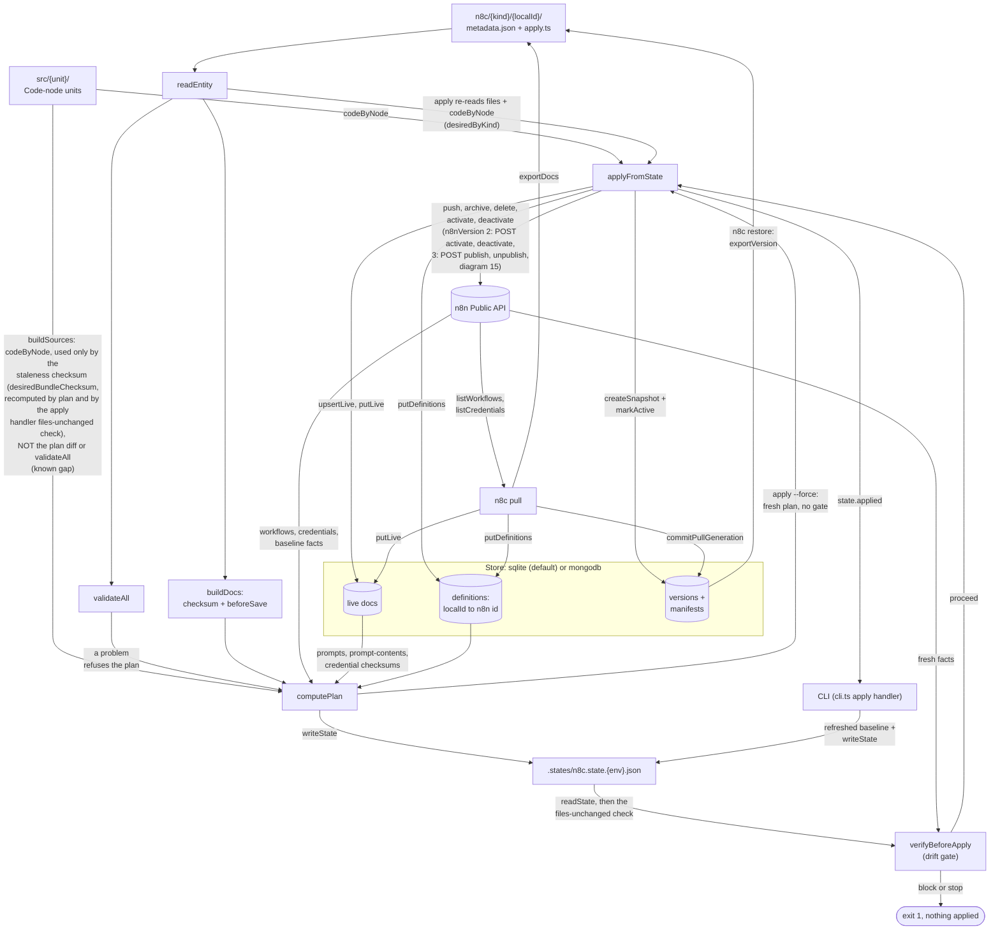

**Source:** `src/cli.ts` (plan, apply, pull, restore handlers), `src/engine/state.ts` (`computePlan`, `writeState`, `readState`, `desiredBundleChecksum`), `src/engine/apply-state.ts` (`applyFromState`), `src/engine/verify.ts` (`verifyBeforeApply`, `refreshedServerFacts`), `src/engine/apply.ts` (`buildDocs`), `src/engine/validate.ts` (`validateAll`), `src/layout.ts` (`readEntity`), `src/engine/build.ts` (`buildSources`), `src/engine/pull.ts`, `src/engine/pull-prompts.ts`, `src/engine/transfer.ts` (`exportDocs`, `exportVersion`).

## 2. Plan: workflow diff

`planAgainstServer` diffs each workflow file against the live n8n body (`planDiff` compares nodes,
then pushed fields, then the active flag); `computePlan` turns the rows into plan resources.
Credentials and prompts are planned differently (diagrams 5 and 12).

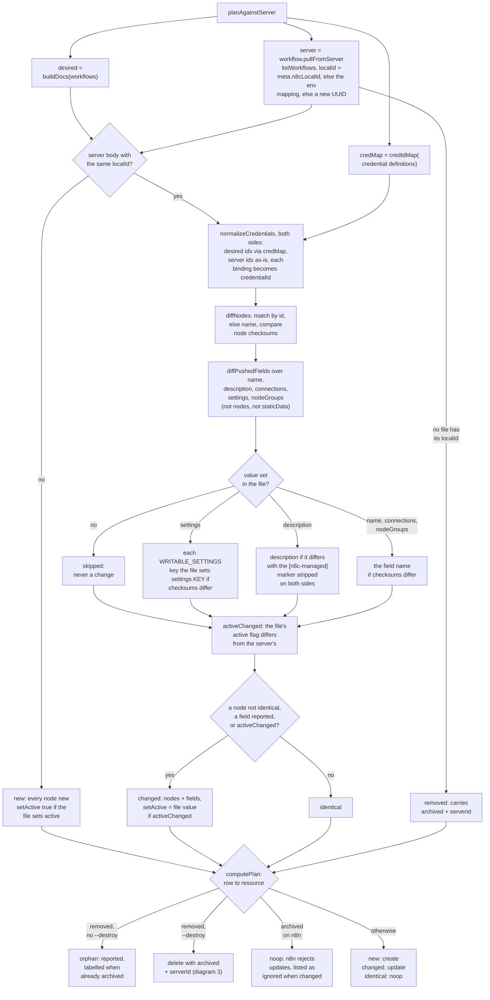

- `checksum()` sorts keys and drops `id`, `createdAt`, `updatedAt` and `versionId` at every depth, so a
  binding compared under `id` would vanish. That is why `normalizeCredentials` emits `credentialId`.
- `diffNodes` compares the normalized bodies; `diffPushedFields` compares the raw ones.
- `plan` prints the reported fields, then the changed node names (`renderChangedParts` in `cli.ts`).

**Source:** `src/engine/plan.ts` (`planAgainstServer`, `planDiff`, `normalizeCredentials`, `diffPushedFields`), `src/engine/apply.ts` (`diffNodes`, `buildDocs`), `src/entities/workflow.ts` (`pullFromServer`, `WRITABLE`, `WRITABLE_SETTINGS`), `src/engine/cred-map.ts` (`credIdMap`), `src/layout.ts` (`stripManagedMarker`), `src/checksum.ts`, `src/engine/state.ts` (`computePlan`, workflows block).

## 3. Apply and destroy

`applyFromState` runs the saved plan row by row: push to n8n first, then commit the DB, so a failed
push never leaves the DB claiming success. Kinds run in a fixed order, so credentials are mapped before
the workflows that reference them. A failing row is recorded and the loop continues.

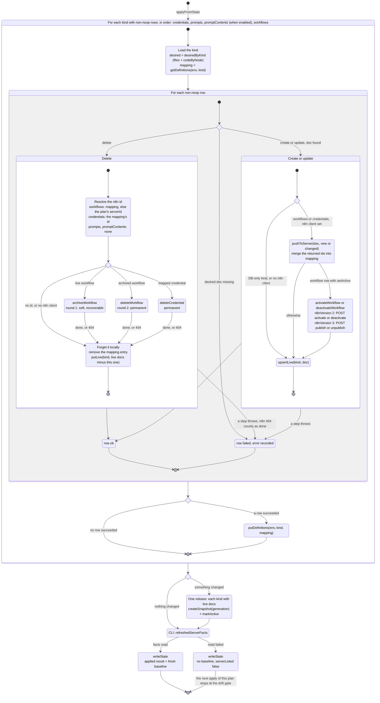

- Removing a workflow that has no file takes two `--destroy` rounds. Round 1 archives a live workflow
  (recoverable); n8n keeps listing it, so the next `plan --destroy` plans it again with
  `archived: true`, and round 2 deletes it permanently. A workflow made in the n8n UI has no mapping,
  so its id is the `serverId` the plan recorded.
- Credentials are deleted permanently in one round; prompts and prompt-contents only leave the DB.
- The refresh and `writeState` steps belong to the CLI (`apply`, and `restore --apply`); `apply` exits 1
  when any row failed.

**Source:** `src/engine/apply-state.ts` (`applyFromState`), `src/engine/state.ts` (`activeKinds`, `desiredByKind`), `src/entities/workflow.ts` and `src/entities/credential.ts` (`pushToServer`), `src/n8n/base.ts` (`archiveWorkflow`, `deleteWorkflow`, `deleteCredential`), `src/n8n/v2.ts` and `src/n8n/v3.ts` (`activateWorkflow`, `deactivateWorkflow`), `src/engine/verify.ts` (`refreshedServerFacts`), `src/cli.ts` (apply and restore handlers).

## 4. Credential secrets

A credential file references its secret as `process.env.NAME`, and the value is resolved when the file
is imported. No secret is ever written to a file. The DB stores the resolved secret, encrypted unless
`credentials.encrypted` is `false` in `n8c.config.json`.

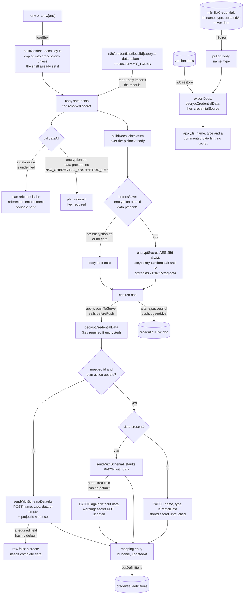

- `sendWithSchemaDefaults` sends, and when n8n answers that fields are missing (`requires property "X"`)
  it fills each one from n8n's own default for the type (`getCredentialSchema` → `collectFieldDefaults`,
  cached per context), else from n8c's `allowedDomains: "*"`, and retries, up to 6 tries. A field with no
  default anywhere ends the loop; any other error is rethrown and worded by `explainCredentialError`.
- The export decrypts the stored body but writes only `name` and `type`; restoring a version whose
  credential data is encrypted therefore needs the key.

**Source:** `src/context.ts` (`buildContext`), `src/env.ts` (`loadEnv`), `src/layout.ts` (`readEntity`), `src/engine/validate.ts` (`validateAll`, rule 4 and the key check), `src/engine/apply.ts` (`buildDocs`), `src/entities/credential.ts` (`beforeSave`, `beforePush`, `decryptCredentialData`, `pushToServer`, `sendWithSchemaDefaults`, `fillMissingFields`, `credentialFieldDefaults`, `explainCredentialError`, `pullFromServer`), `src/crypto.ts`, `src/engine/types-gen.ts` (`collectFieldDefaults`), `src/engine/transfer.ts` (`exportDocs`, `credentialSource`), `src/n8n/base.ts` (`createCredential`, `updateCredential`, `getCredentialSchema`), `src/engine/apply-state.ts`.

## 5. Credential ids and node bindings

Files only ever hold credential localIds. Each env's definitions map them to n8n ids; the plan, the
push and the export each translate through that mapping.

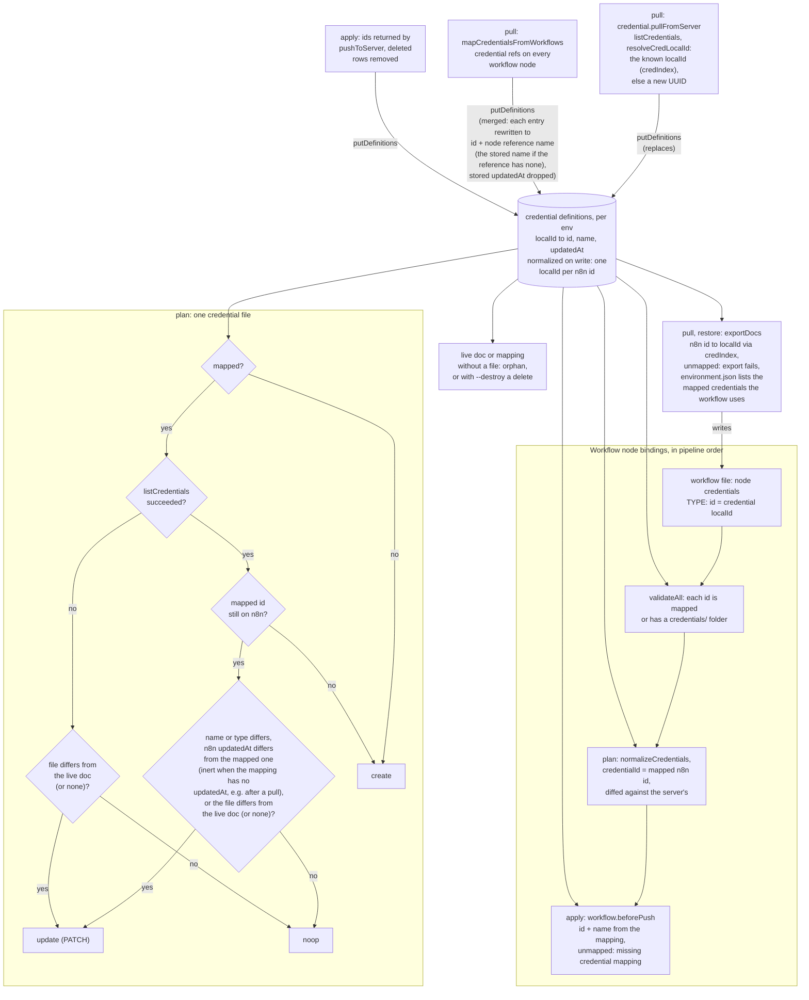

- The pull writes the credential mapping with replace semantics from `listCredentials`, which only sees
  credentials the API key can reach; `mapCredentialsFromWorkflows` then merges every node reference back
  in, so a credential from another n8n project still resolves on export. The merge (`resolveCredLocalId`)
  rewrites each existing entry to `{ id, name }` (the node reference's name, falling back to the stored name when the reference has none), discarding the `updatedAt` the
  credential pull just stored, so the plan's "n8n updatedAt differs" check is inert after a pull for every
  node-referenced credential until n8c next pushes it (known bug, being fixed separately).
- `apply` runs the credentials kind first and saves its mapping before workflows push, so
  `workflow.beforePush` can bind a credential created in the same apply.

**Source:** `src/engine/cred-map.ts` (`credIndex`, `credIdMap`, `resolveCredLocalId`, `normalizeMapping`), `src/entities/credential.ts` (`pullFromServer`, `pushToServer`), `src/engine/environment.ts` (`mapCredentialsFromWorkflows`), `src/engine/pull.ts` (`pullEntity`), `src/engine/state.ts` (credentials block of `computePlan`), `src/engine/validate.ts`, `src/engine/plan.ts` (`normalizeCredentials`), `src/entities/workflow.ts` (`beforePush`), `src/engine/transfer.ts` (`exportDocs`), `src/engine/materialize.ts` (`relinkCredentials`), `src/engine/apply-state.ts`.

## 6. Store

One `Store` interface; `createStore` picks the adapter from `database` in `n8c.config.json`.

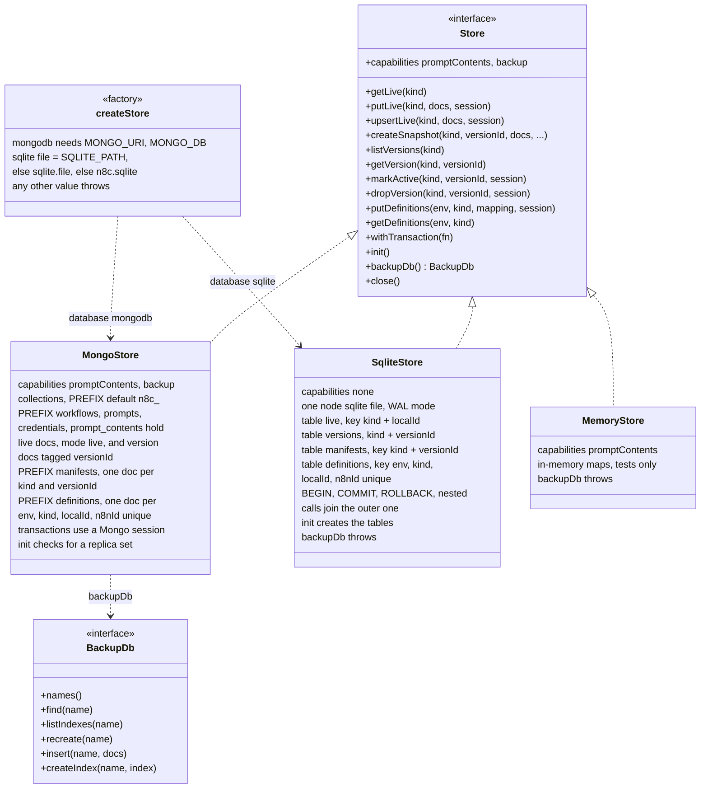

| | MongoStore | SqliteStore | MemoryStore |
|---|---|---|---|
| `capabilities.promptContents` | `true` | `false` (the engine skips the kind) | `true` |
| `capabilities.backup` | `true` | `false` | `false` |
| `backupDb()` (`db export` / `db import`) | adapter over the collections | throws | throws |
| built by `createStore` | `database: "mongodb"` | `database: "sqlite"` (the default) | never (tests only) |

- Only `capabilities.promptContents` is read by the engine (through `ctx.promptContentsEnabled`);
  `db export` / `db import` call `backupDb()` directly and rely on it throwing.
- MongoStore specifics: `putLive` and `upsertLive` store `liveStorageDoc` (promptContents bodies are
  spread to the top level); `getLive` rebuilds those bodies, even for externally seeded docs;
  `getVersion` falls back to legacy manifest-embedded docs (`selectVersionDocs`); `getDefinitions`
  also reads the legacy single-doc mapping.
- Every `putDefinitions` replaces the `{env, kind}` mapping and normalizes it (`mappingRows` /
  `normalizeMapping`), so each n8n id maps to exactly one localId, UUID-shaped preferred.
- `PREFIX` is `collectionPrefix` (default `n8c_`); any single name can be overridden through
  `collections` (`resolveCollections`). The sqlite table names are fixed.
- `sqlite-quiet.ts` is imported before `node:sqlite` loads, to silence its experimental warning.

**Source:** `src/store/store.ts`, `src/store/factory.ts` (`createStore`), `src/store/mongo.ts`, `src/store/sqlite.ts`, `src/store/sqlite-quiet.ts`, `src/store/memory.ts`, `src/store/collections.ts` (`resolveCollections`, `collectionForKind`), `src/store/live-doc.ts` (`liveStorageDoc`), `src/store/version-docs.ts` (`selectVersionDocs`), `src/engine/cred-map.ts` (`mappingRows`, `normalizeMapping`), `src/engine/backup.ts` (`dumpBackup`, `restoreBackup`), `src/context.ts`.

## 7. Workflow layouts

A workflow folder is read in one of two layouts. In the flat one `apply.ts` owns the body; in the
exploded one (a `nodes/` folder) the body is assembled from `metadata.json` and per-node files.

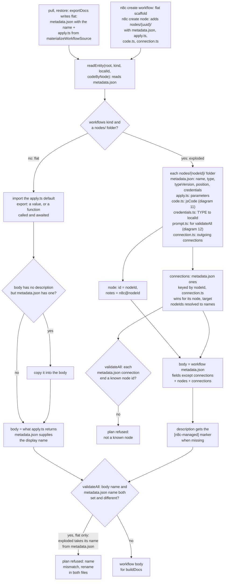

- In the exploded layout, a `credentials.ts` replaces the node's `metadata.json` credentials.

**Source:** `src/layout.ts` (`readEntity`, `writeEntity`, `MANAGED_MARKER`), `src/engine/validate.ts` (`validateAll` rules 0 and 3), `src/engine/transfer.ts` (`exportDocs`), `src/engine/materialize.ts` (`materializeWorkflowSource`), `src/engine/generate.ts` (`createEntity`).

## 8. Versions and generations

Every apply that changes something, and every pull that finds a difference, writes one generation: all
kinds snapshotted under one `versionId`. `list`, `restore` and `drop` address generations, never a
single kind.

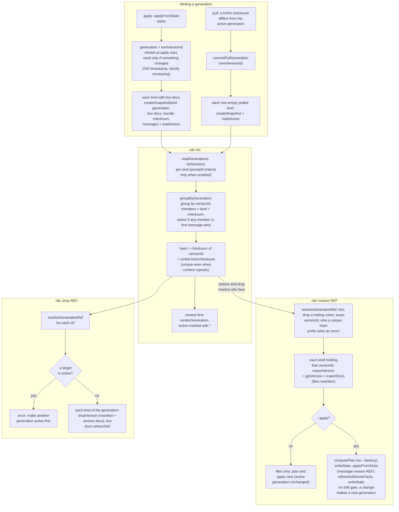

**Source:** `src/engine/apply-state.ts` (pass 2), `src/engine/pull.ts` (`commitPullGeneration`), `src/version.ts` (`nextVersionId`), `src/cli.ts` (`readGenerations`, `groupByGeneration`, `resolveGenerationRef`, `renderGeneration`; list, pull, restore and drop handlers), `src/engine/list.ts` (`listEntity`), `src/engine/transfer.ts` (`exportVersion`), `src/store/*` (`createSnapshot`, `markActive`, `listVersions`, `getVersion`, `dropVersion`).

## 9. Drift gate

`plan` records a baseline of the instance; `apply` re-reads it and refuses when something the plan is
about to write changed on n8n in the meantime.

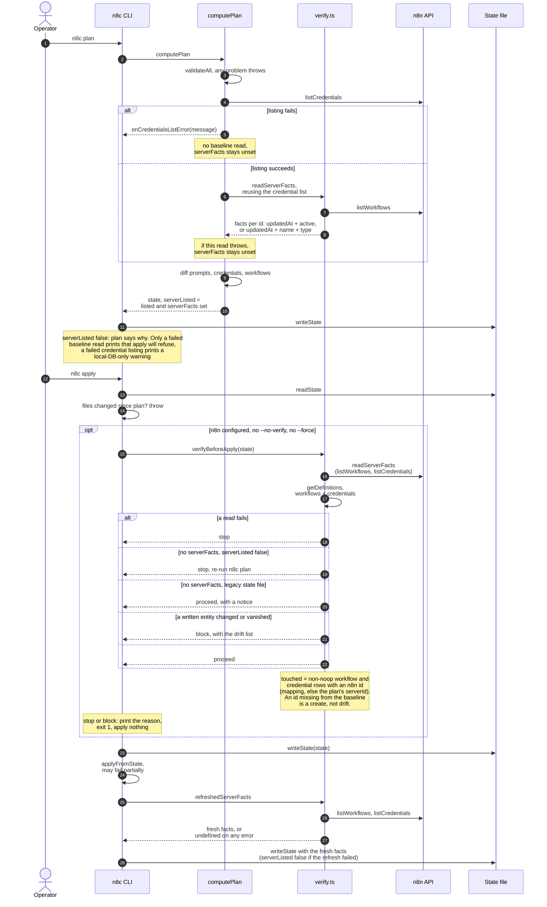

The baseline is refreshed after every apply, even a partial one, so a retry does not see this apply's
own writes as drift. `apply --force` plans fresh and skips the gate.

**Source:** `src/engine/state.ts` (`computePlan`), `src/engine/verify.ts` (`readServerFacts`, `verifyBeforeApply`, `touchedFromState`, `driftFor`, `refreshedServerFacts`), `src/cli.ts` (plan and apply handlers).

## 10. MCP server

`n8c mcp` speaks MCP over stdio and runs each tool call as a real CLI child process, one at a time.

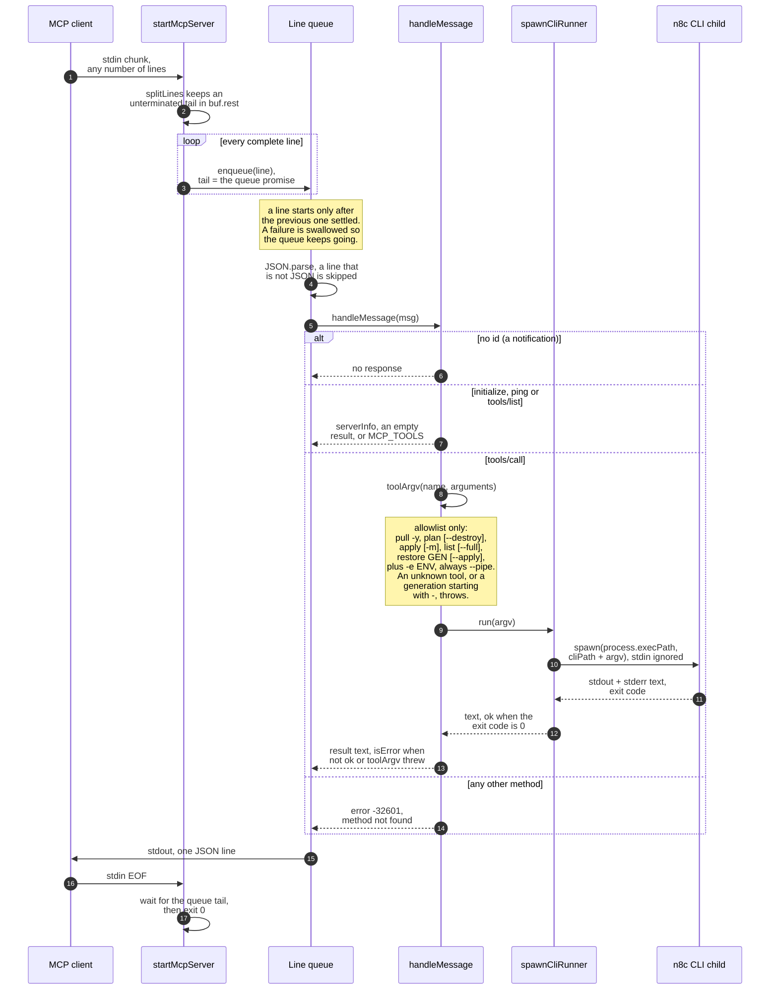

**Source:** `src/mcp/server.ts` (`startMcpServer`, `splitLines`, `makeLineHandler`, `spawnCliRunner`), `src/mcp/protocol.ts` (`handleMessage`, `toolArgv`, `MCP_TOOLS`), `src/cli.ts` (`mcp` command).

## 11. Build and inline units

Code-node source is written as TypeScript and inlined into one self-contained `jsCode` string, since
an n8n Code node cannot import. There are two sources: project units under `src/` that target a node
id, and the `code.ts` of a node in an exploded workflow.

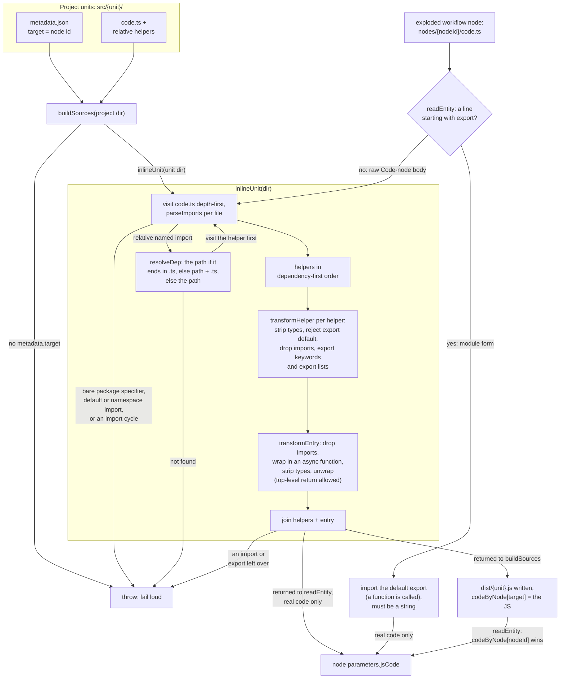

- `codeByNode` reaches `readEntity` only through `desiredBundleChecksum` and `applyFromState`, and only
  exploded workflows apply it. `planAgainstServer` builds workflow docs without it, and the
  `buildSources` result inside `computePlan` is unused, so the workflow diff does not see a change that
  lives only in a `src/{unit}`.
- "Real code" means something other than comments and whitespace remains.

**Source:** `src/engine/build.ts` (`buildSources`), `src/build/inline.ts` (`inlineUnit`, `parseImports`, `resolveDep`, `transformHelper`, `transformEntry`), `src/layout.ts` (`readEntity` code.ts branch, `hasRealCode`), `src/engine/state.ts` (`computePlan`, `desiredBundleChecksum`), `src/engine/apply-state.ts` (`applyFromState`), `src/engine/plan.ts` (`planAgainstServer`).

## 12. Prompts

Two DB-only kinds that never reach n8n through the API. `prompts` are extracted from LLM nodes and
versioned on any backend. `promptContents` is a runtime registry that an n8n node reads straight from
Mongo, so it exists only on the mongodb backend.

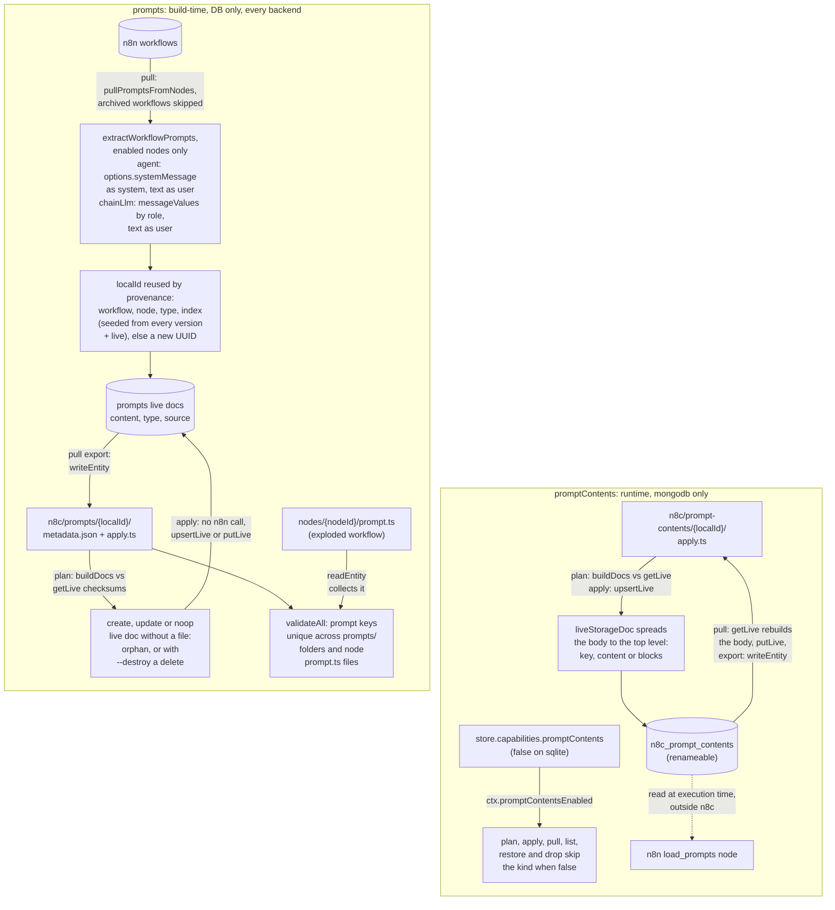

- Nothing writes prompt docs back into workflow nodes: a prompt file is versioned and diffed on its own.
- A node's `prompt.ts` is only validated. `workflow.collectExtra`, which would store it as a live prompt,
  is called only from `applyEntity` in `src/engine/apply.ts`, and no command calls `applyEntity`.

**Source:** `src/engine/pull-prompts.ts` (`pullPromptsFromNodes`), `src/engine/extract-prompts.ts` (`extractWorkflowPrompts`), `src/engine/state.ts` (DB-live diff in `computePlan`, `activeKinds`), `src/engine/apply-state.ts`, `src/engine/validate.ts`, `src/layout.ts` (`readEntity` prompt.ts branch, `writeEntity`), `src/entities/prompt.ts`, `src/entities/prompt-content.ts`, `src/entities/workflow.ts` (`collectExtra`), `src/store/live-doc.ts` (`liveStorageDoc`), `src/store/mongo.ts` (`getLive`, `putLive`, `upsertLive`), `src/context.ts`, `src/cli.ts` (pull groups, `readGenerations`).

## 13. Pull and export

`n8c pull` makes the DB and the files mirror n8n: fetch every kind, commit one generation if anything
changed, then rewrite the files.

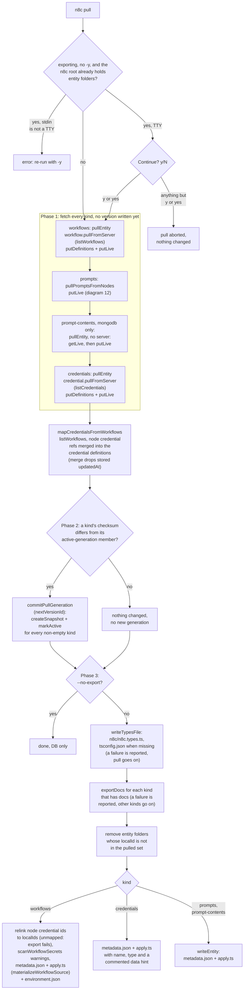

- A kind whose pulled set is empty is not exported, so its old folders are not pruned.
- Prompt-contents is skipped on sqlite (diagram 12).

**Source:** `src/cli.ts` (pull handler, `dirHasEntities`, `writeTypesFile`, `printSecretWarnings`), `src/engine/pull.ts` (`pullEntity`, `commitPullGeneration`), `src/engine/pull-prompts.ts`, `src/engine/environment.ts` (`mapCredentialsFromWorkflows`), `src/engine/transfer.ts` (`exportDocs`, `credentialSource`), `src/engine/materialize.ts` (`materializeWorkflowSource`), `src/engine/secret-scan.ts` (`scanWorkflowSecrets`), `src/layout.ts` (`writeEntity`), `src/engine/types-gen.ts`.

## 14. CLI commands and context

How a command line becomes a call: global flags, the per-command handler, and the context most handlers
build first.

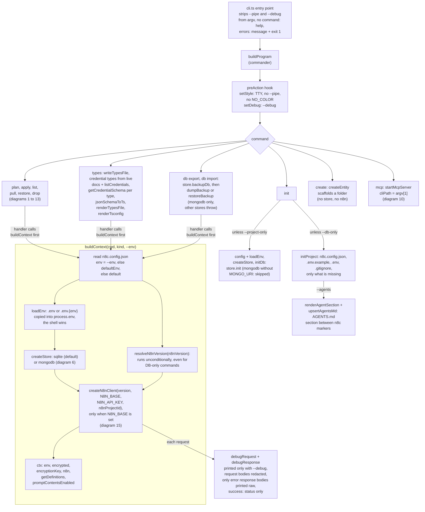

**Source:** `src/cli.ts` (`buildProgram`, `isEntryPoint`, `writeTypesFile`, init / types / db / create / mcp handlers), `src/context.ts` (`buildContext`), `src/env.ts` (`loadEnv`), `src/store/factory.ts` (`createStore`), `src/engine/init.ts` (`initProject`, `initDb`), `src/engine/agent-context.ts` (`renderAgentSection`, `upsertAgentsMd`), `src/engine/types-gen.ts` (`fetchCredentialTypes`, `jsonSchemaToTs`, `renderTypesFile`, `renderTsconfig`), `src/engine/backup.ts` (`dumpBackup`, `restoreBackup`), `src/engine/generate.ts` (`createEntity`), `src/style.ts`, `src/debug.ts` (`redact`, `debugRequest`, `debugResponse`), `src/n8n/index.ts` (`resolveN8nVersion`, `createN8nClient`), `src/n8n/base.ts` (constructor, `req`).

## 15. n8n API clients (2.x / 3.x)

n8c talks to n8n 2.x and 3.x only. `n8nVersion` in `n8c.config.json` picks the client class; the engine never
branches on version, it calls the same method names on either.

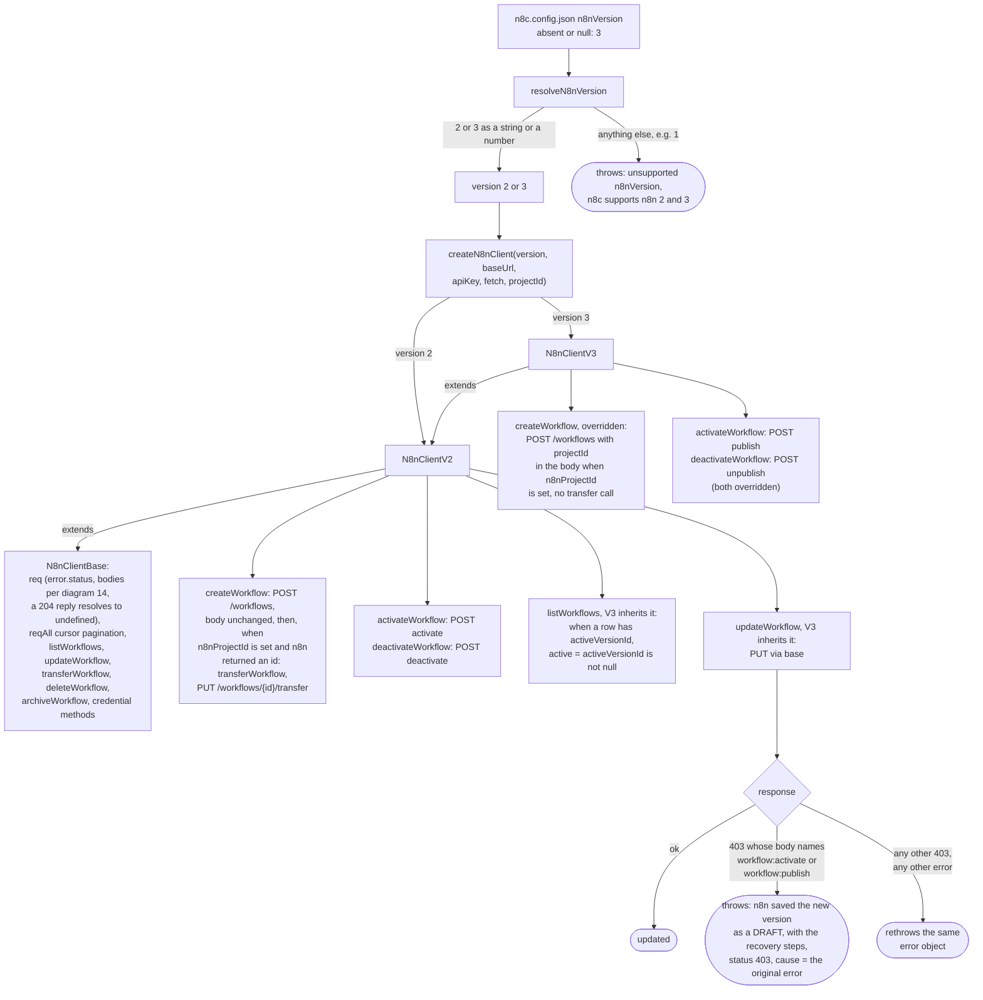

- `/publish`, `/unpublish` and `projectId` on create only arrived during 2.x (publish and unpublish in 2.33), so
  `N8nClientV2` activates, deactivates and assigns a project through `/activate`, `/deactivate` and `/transfer`,
  which all of 2.x serves. `N8nClientV3` overrides `createWorkflow`, `activateWorkflow` and `deactivateWorkflow`
  for n8n 3.x; the endpoints it uses also exist from 2.33.
- n8n answers the transfer with 204 and no body, so `req` returns `undefined` for a 204 instead of parsing it.
- A PUT on a published workflow makes n8n re-publish it. When n8n refuses that publish with a 403 whose body names
  `workflow:activate` or `workflow:publish`, it still keeps the new version as a draft, so the error says that and
  how to recover: grant the permission and re-run `n8c apply` on the same saved plan (a fresh `n8c plan` compares
  against the saved draft and shows no change), or set `active: false` in the workflow's file. Any other 403 (for
  example a key without `workflow:update`, where nothing was saved) passes through unchanged.
- `listWorkflows` leaves a row untouched when it carries no `activeVersionId` field.

**Source:** `src/n8n/index.ts` (`resolveN8nVersion`, `createN8nClient`), `src/n8n/base.ts` (`N8nClientBase`: `req`, `transferWorkflow`), `src/n8n/v2.ts` (`N8nClientV2`), `src/n8n/v3.ts` (`N8nClientV3`), `src/context.ts` (`buildContext`), `src/engine/init.ts` (`DEFAULT_CONFIG`).
